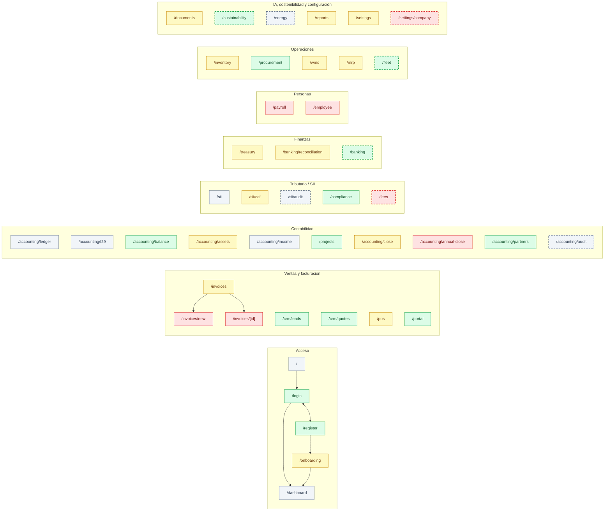

# Mapa Funcional — SII-ERP-AI

> Inventario de todas las pantallas del producto, cómo se llega a cada una, qué funciona de verdad y qué hay en el backend que no tiene pantalla. Es la base para reorganizar la navegación.
>
> **Cómo se hizo:** cruce mecánico de los `page.tsx`, el menú (`Sidebar.tsx`), las llamadas a la API del front y los endpoints del backend (`@*Mapping`), con datos extraídos el 14-11-2026.
>
> **Limitación:** solo se detectan las llamadas escritas como texto (`api.get('/ruta')`). Si una pantalla llama a la API usando constantes (`API_ROUTES.X`), aparece como "sin API detectada" y queda marcada **[verificar]**.

---

## 1. Resumen

| | Cantidad |
|---|---|
| Pantallas (`page.tsx`) | **43** |
| Accesibles desde el menú | 29 |
| Accesibles solo por un link en otra pantalla | 2 (`/invoices/new`, `/invoices/[id]`) |
| Auth y raíz (login, registro, onboarding, `/`) | 4 |
| **Sin ningún acceso desde la interfaz** | **8** — ver §3 |
| Llamadas del front a endpoints que **no existen** | **10** — ver §4 |
| Acciones que hoy son **simuladas** (código comentado) | 4 — ver §5 |
| Endpoints del backend | 224 (70 son del módulo de energía) |
| Roles que conoce el front | 3 de 9 (`ADMIN`, `ACCOUNTANT`, `USER`) |

**Hallazgos principales para el diseño**
1. **No se puede crear una factura desde la interfaz.** `/invoices/new` tiene 15 líneas y no llama a `POST /invoices`, aunque el backend lo tiene. Es el flujo central del producto.
2. **El detalle de factura no funciona.** `/invoices/[id]` llama a 3 endpoints que no existen.
3. **El menú se muestra igual a todos los roles.** Un usuario de ventas ve Contabilidad, Remuneraciones, etc., y al entrar recibe errores de permiso.
4. **8 pantallas existen pero no se pueden abrir** desde la interfaz, entre ellas Honorarios, Flota, Sostenibilidad, Energía y Banca.
5. **Hay pantallas que su propio público no puede usar**: el portal del empleado exige rol ADMIN o HR, y Centro de Costos (en el menú de Contabilidad) no permite al contador.

---

## 2. Inventario de pantallas

**Estados**
- **Conectada:** todas sus llamadas a la API existen en el backend.
- **Parcial:** funciona, pero le faltan acciones (p. ej. solo lectura aunque el backend permite crear).
- **Con fallas:** alguna de sus llamadas apunta a un endpoint que no existe.
- **Rota:** su función principal no puede funcionar.
- **Simulada:** muestra datos o acciones falsas (mock o llamada comentada).
- **Sin API detectada:** no se encontraron llamadas como texto **[verificar]**.

Columna *Roles*: los que acepta el backend (`@PreAuthorize` del controller).

### 2.1 Ventas y facturación

| Ruta | Menú | Estado | Qué hace / qué pasa | Roles | Archivo (líneas) |
|------|------|--------|---------------------|-------|------------------|
| `/invoices` | Facturas | **Parcial** | Lista facturas (`GET /invoices` ✓) y las envía por email (`POST /invoices/{id}/send` ✓). **Importar CSV es simulado**, aunque el backend tiene `POST /invoices/import` | ADMIN, SALES, ACCOUNTANT | `invoices/page.tsx` (103) |
| `/invoices/new` | No (botón en `/invoices`) | **Rota** | Placeholder: no llama a `POST /invoices`. **No se pueden emitir facturas desde la UI** | ADMIN, SALES, ACCOUNTANT | `invoices/new/page.tsx` (15) |
| `/invoices/[id]` | No (clic en fila) | **Rota** | Llama a `GET /invoices/{id}` ✗, `GET /accounting/entries/by-invoice/{id}` ✗ y `GET /invoices/{id}/audit-trail` ✗ | ADMIN, SALES, ACCOUNTANT | `invoices/[id]/page.tsx` (214) |
| `/crm/leads` | Ventas CRM › Pipeline | Conectada | Leads: listar, crear, cambiar estado | ADMIN, SALES | `crm/leads/page.tsx` (103) |
| `/crm/quotes` | Ventas CRM › Cotizaciones | Conectada | Cotizaciones: listar, crear, aceptar, rechazar. No hay "convertir en factura" | ADMIN, SALES | `crm/quotes/page.tsx` (111) |
| `/pos` | Punto de Venta | **Con fallas** | Ventas y sincronización ✓; **búsqueda de producto por código** (`GET /pos/products/search`) ✗. Contiene datos mock | ADMIN, SALES | `pos/page.tsx` (145) |
| `/portal` | Portal B2B | Conectada | Portal del **cliente** B2B: sus pedidos, crear pedido, pagar. Está fuera del layout con menú (`app/portal/`), pero aparece en el menú interno | Sin `@PreAuthorize` (cualquier usuario autenticado) | `portal/page.tsx` (65) |

### 2.2 Contabilidad

| Ruta | Menú | Estado | Qué hace / qué pasa | Roles | Archivo (líneas) |
|------|------|--------|---------------------|-------|------------------|
| `/accounting/ledger` | Contabilidad › Libro Diario | Sin API detectada | Backend disponible: `GET /accounting/entries`, `GET /accounting/ledger/{accountCode}` | ADMIN, ACCOUNTANT | `accounting/ledger/page.tsx` (36) |
| `/accounting/f29` | Contabilidad › Form 29 | Sin API detectada | Backend disponible: `GET /accounting/f29`, `POST /reports/f29/submit` | ADMIN, ACCOUNTANT | `accounting/f29/page.tsx` (32) |
| `/accounting/balance` | Contabilidad › Balance | Conectada | `GET /accounting/balance-sheet` ✓, con drill-down por cuenta | ADMIN, ACCOUNTANT | `accounting/balance/page.tsx` (76) |
| `/accounting/assets` | Contabilidad › Activos Fijos | Parcial | Lista y corre la depreciación ✓. **No permite crear activos**, aunque existe `POST /fixed-assets` | ADMIN, ACCOUNTANT | `accounting/assets/page.tsx` (78) |
| `/accounting/income` | Contabilidad › Estado Resultados | Sin API detectada | Existen **dos** endpoints de estado de resultados (`/accounting/reports/income-statement` y `/reports/income-statement`) | ADMIN, ACCOUNTANT (AUDITOR en `/reports`) | `accounting/income/page.tsx` (98) |
| `/projects` | Contabilidad › Centro de Costos | Conectada | Proyectos: listar, ver, crear, cambiar estado. ⚠️ Está en el menú de Contabilidad, pero **el contador no tiene acceso** | ADMIN, OPERATIONS | `projects/page.tsx` (96) |
| `/accounting/close` | Contabilidad › ✨ Cierre de Período IA | Parcial | Auditoría y ejecución del cierre ✓ (`/period-close/audit`, `/execute`). Contiene datos mock | ADMIN, ACCOUNTANT | `accounting/close/page.tsx` (416) |
| `/accounting/annual-close` | Contabilidad › 🌟 Cierre Anual (F22) | **Simulada** | No llama a la API. El backend tiene `POST /annual-close/f22/calculate/{año}` | ADMIN, ACCOUNTANT | `accounting/annual-close/page.tsx` (397) |
| `/accounting/partners` | Conciliación y Control › Cuentas Corrientes | Conectada | Saldos por cliente/proveedor ✓. No usa el detalle de movimientos (`/{rut}/movements`) | ADMIN, ACCOUNTANT | `accounting/partners/page.tsx` (28) |
| `/accounting/audit` | **No (sin acceso)** | Sin API detectada | Backend disponible: alertas, duplicados, sospechosos, conciliación y reporte (`/audit/*`) | ADMIN, AUDITOR | `accounting/audit/page.tsx` (14) |

### 2.3 Tributario / SII

| Ruta | Menú | Estado | Qué hace / qué pasa | Roles | Archivo (líneas) |
|------|------|--------|---------------------|-------|------------------|
| `/sii` | SII › Sincronizar | Sin API detectada | Backend disponible: `POST /sii/ops/fetch-rcv` | ADMIN, ACCOUNTANT | `sii/page.tsx` (28) |
| `/sii/caf` | SII › CAF | Parcial | Sube CAF ✓. **No existe un endpoint para listar los CAF cargados**, así que no se pueden ver folios disponibles | ADMIN, ACCOUNTANT | `sii/caf/page.tsx` (105) |
| `/sii/audit` | **No (sin acceso)** | Sin API detectada | Backend disponible: `GET /sii/audit/report` y `GET /accounting/audit/sii-mirror` | ADMIN, ACCOUNTANT, AUDITOR | `sii/audit/page.tsx` (24) |
| `/compliance` | Conciliación y Control › Compliance Center | Conectada | Panel de salud tributaria (`GET /compliance/dashboard` ✓) | ADMIN, ACCOUNTANT | `compliance/page.tsx` (126) |
| `/fees` | **No (sin acceso)** | **Rota** | Lista con `GET /fees` ✗ (no existe). **Importar boletas es simulado**, aunque existe `POST /fees/import` | ADMIN, ACCOUNTANT | `fees/page.tsx` (43) |

### 2.4 Finanzas y tesorería

| Ruta | Menú | Estado | Qué hace / qué pasa | Roles | Archivo (líneas) |
|------|------|--------|---------------------|-------|------------------|
| `/treasury` | Tesorería | **Con fallas** | Pronóstico IA ✓. Tipos de cambio (`/treasury/exchange-rates`) ✗. **Registrar movimiento de caja es simulado**: el front usaría `/cash-entries` y el backend tiene `/cash-entry`. Subir cartola: simulado, sin backend. El backend también ofrece flujo de caja diario y ratios financieros, sin uso | ADMIN, TREASURER, ACCOUNTANT | `treasury/page.tsx` (51) |
| `/banking/reconciliation` | Conciliación y Control › Conciliación Bancaria | Parcial | Movimientos, conciliar e ignorar ✓. Contiene mock. ⚠️ **El contador no tiene acceso**, aunque el commit `4446cf6` dice que debería | ADMIN, TREASURER | `banking/reconciliation/page.tsx` (162) |
| `/banking` | **No (sin acceso)** | Conectada | Conexiones bancarias (Open Banking) y sincronización | ADMIN, TREASURER | `banking/page.tsx` (19) |

### 2.5 Personas

| Ruta | Menú | Estado | Qué hace / qué pasa | Roles | Archivo (líneas) |
|------|------|--------|---------------------|-------|------------------|
| `/payroll` | Remuneraciones | **Con fallas** | **La lista de empleados no carga** (`GET /payroll/employees` ✗). Calcular ✓ (con `periodId: 1` fijo en el código), exportar Previred ✓, PDF de liquidación ✗ | ADMIN, HR | `payroll/page.tsx` (160) |
| `/employee` | Mi Portal (Empleado) | **Rota para su público** | Usa `GET /payroll/employee/payslips` ✓, pero ese endpoint exige ADMIN o HR: **un empleado normal recibe error de permiso** | ADMIN, HR | `employee/page.tsx` (63) |

### 2.6 Operaciones

| Ruta | Menú | Estado | Qué hace / qué pasa | Roles | Archivo (líneas) |
|------|------|--------|---------------------|-------|------------------|
| `/inventory` | Inventario | Parcial / con fallas | Lista productos ✓; exportar Excel ✗. Hook con mock. **No permite crear, editar ni registrar movimientos**, aunque el backend lo tiene | ADMIN, OPERATIONS | `inventory/page.tsx` (168) |
| `/procurement` | Adquisiciones | Conectada | Órdenes de compra: listar, ver, crear, marcar enviada y recibida | ADMIN, OPERATIONS | `procurement/page.tsx` (113) |
| `/wms` | Logística (WMS) | Parcial | Ubicaciones y picking: solo lectura y completar. **No permite crear** ubicaciones ni picking | ADMIN, OPERATIONS | `wms/page.tsx` (92) |
| `/mrp` | Producción (MRP) | Parcial | Listas de materiales y órdenes: solo lectura y completar. **No permite crear** | ADMIN, OPERATIONS | `mrp/page.tsx` (92) |
| `/fleet` | **No (sin acceso)** | Conectada | Métricas de flota (`/fleet/metrics`, único endpoint del módulo) | ADMIN, OPERATIONS | `fleet/page.tsx` (81) |

### 2.7 IA y documentos

| Ruta / componente | Menú | Estado | Qué hace / qué pasa | Roles | Archivo |
|-------------------|------|--------|---------------------|-------|---------|
| `/documents` | Gestor Documental (IA) | Parcial | Lista documentos y los analiza ✓. Subir (`POST /dms`) no detectado **[verificar]** | ADMIN, ACCOUNTANT | `documents/page.tsx` (71) |
| Chat IA (`AiChat`, `actions.tsx`) | Header | **[verificar]** | Crea conversación y envía mensajes ✓, pero el contenedor `AiDrawer` está vacío; hay que confirmar si el chat se ve | Sin `@PreAuthorize` | `features/ai-assistant/` |

### 2.8 Sostenibilidad y energía

| Ruta | Menú | Estado | Qué hace / qué pasa | Roles | Archivo (líneas) |
|------|------|--------|---------------------|-------|------------------|
| `/sustainability` | **No (sin acceso)** | Conectada | Reporte ESG y simulador Corfo | ADMIN, OPERATIONS, AUDITOR | `sustainability/page.tsx` (149) |
| `/energy` | **No (sin acceso)** | Sin API detectada | No usa ninguno de los **70 endpoints** de energía (cargadores, precios, mantenimiento, OCPP) | ADMIN, OPERATIONS | `energy/page.tsx` (116) |

### 2.9 Inicio, configuración y acceso

| Ruta | Menú | Estado | Qué hace / qué pasa | Roles | Archivo (líneas) |
|------|------|--------|---------------------|-------|------------------|
| `/dashboard` | Dashboard | Sin API detectada | Widget de salud financiera usa `/financial-shield/health` ✓ (ADMIN, ACCOUNTANT, TREASURER). Ojo: `/api/v1/dashboard/*` en el backend es **del módulo de energía**, no de este dashboard | — | `dashboard/page.tsx` (66) |
| `/reports` | Reportes | Parcial | Reporte de ventas en Excel ✓. Contiene mock | ADMIN, ACCOUNTANT, AUDITOR | `reports/page.tsx` (88) |
| `/settings` | Configuración | **Con fallas** | Perfil de empresa ✓, usuarios ✓, invitar ✓. **Eliminar usuario no funciona** (`DELETE /sso/users/{id}` ✗). Cambiar rol existe en el backend y no se usa | ADMIN | `settings/page.tsx` (34) |
| `/settings/company` | **No (sin acceso)** | Simulada | Placeholder; el menú apunta a `/settings` | — | `settings/company/page.tsx` (12) |
| `/login` | — | Conectada | Formulario de login → `/dashboard` | Pública | `(auth)/login/page.tsx` |
| `/register` | — | Conectada | Registro → `/login` | Pública | `(auth)/register/page.tsx` |
| `/onboarding` | — (solo tras registro) | Parcial | Asistente de configuración inicial; guarda el perfil de empresa ✓. Contiene mock | — | `(auth)/onboarding/page.tsx` (166) |
| `/` | — | — | Redirección | — | `app/page.tsx` (5) |

---

## 3. Pantallas sin acceso desde la interfaz

Existen, pero no hay ningún enlace a ellas: ni en el menú, ni en el header (que no tiene enlaces), ni en otras pantallas. Solo se abren escribiendo la URL.

| Pantalla | Estado | Comentario |
|----------|--------|------------|
| `/fees` Honorarios | Rota | Funcionalidad tributaria relevante (boletas de honorarios) |
| `/banking` Conexiones bancarias | Conectada | Es el paso previo a la conciliación: sin ella no hay movimientos que conciliar |
| `/sii/audit` Auditoría SII | Sin API detectada | |
| `/accounting/audit` Auditoría contable | Sin API detectada | Es la única pantalla pensada para el rol AUDITOR |
| `/fleet` Flota | Conectada | |
| `/sustainability` Sostenibilidad | Conectada | |
| `/energy` Energía | Sin API detectada | |
| `/settings/company` | Simulada | Duplicado de `/settings`; probablemente se puede eliminar |

---

## 4. Llamadas a endpoints que no existen

| Llamada del front | Archivo | Efecto en la pantalla |
|-------------------|---------|-----------------------|
| `GET /invoices/{id}` | `invoicing/services/invoice.service.ts:69` | El detalle de factura no carga |
| `GET /accounting/entries/by-invoice/{id}` | `accounting/services/accounting.service.ts:131` | No se ve el asiento de la factura |
| `GET /invoices/{id}/audit-trail` | `accounting/services/accounting.service.ts:140` | No se ve el historial de la factura |
| `GET /payroll/employees` | `payroll/hooks/usePayroll.ts:19` | La lista de empleados no carga |
| `GET /payroll/payslip/{id}/pdf` | `payroll/components/PayrollDashboard.tsx:36` | No se descarga la liquidación |
| `GET /fees` | `fees/services/fee.service.ts:27` | La lista de honorarios no carga |
| `GET /treasury/exchange-rates` | `treasury/services/treasury.service.ts:18` | No se muestran tipos de cambio |
| `GET /inventory/export/excel` | `inventory/components/InventoryDashboard.tsx:42` | Exportar inventario falla |
| `GET /pos/products/search` | `pos/services/pos.service.ts:47` | No se puede buscar producto por código en el POS |
| `DELETE /sso/users/{id}` | `settings/services/settings.service.ts:93` | No se puede eliminar un usuario |

Además, `API_ROUTES` (`lib/constants.ts`) define rutas sin endpoint en el backend: `/sii/dte/send`, `/bank/upload`, `/bank/reconciliation`, `/bank/reconcile`, `/ai/chat`, `/accounting/entries/correct`. **[verificar]** si alguna pantalla las usa.

---

## 5. Acciones simuladas (la llamada está comentada)

| Acción | Archivo | ¿Existe en el backend? |
|--------|---------|------------------------|
| Importar facturas CSV | `invoicing/components/CsvImportModal.tsx:39` | **Sí**: `POST /invoices/import` — solo falta conectarlo |
| Importar boletas de honorarios | `fees/components/FeeImportModal.tsx:30` | **Sí**: `POST /fees/import` — solo falta conectarlo |
| Registrar movimiento de caja | `treasury/components/CashEntryModal.tsx:44` | **Sí**, como `POST /treasury/cash-entry` (el front usaba `cash-entries`) |
| Subir cartola bancaria | `treasury/components/BankStatementUpload.tsx:23` | No |

---

## 6. Backend sin pantalla

| Área | Endpoints sin uso en el front | Para qué sirven |
|------|-------------------------------|-----------------|
| **Facturación** | `POST /invoices` | **Crear factura** |
| Contabilidad | `/accounting/accounts` (GET, POST), `/opening-balance` y `/opening-balance/upload`, `/ledger/{accountCode}`, `/periods/closed`, `/periods/{period}/status` | Plan de cuentas, saldos de apertura, libro mayor por cuenta, estado de períodos |
| Reportes | `/reports/weekly/generate`, `/reports/income-statement`, `/reports/balance-sheet`, `/reports/f29/submit` | Reporte semanal, estados financieros, envío F29 |
| Auditoría | `/audit/alerts`, `/duplicates`, `/suspicious`, `/reconciliation`, `/report`; `/sii/audit/report`; `/accounting/audit/sii-mirror` y `/sii-sync` | Detección de anomalías y espejo SII–ERP |
| Clasificación automática | `/learning/rules` (CRUD completo) | Reglas de clasificación contable |
| Limpieza de datos | `POST /accounting/cleanup/november-rcv` (solo ADMIN) | Limpieza puntual de un mes; **revisar si debe seguir en producción** |
| Cierre anual | `POST /annual-close/f22/calculate/{año}` | Cálculo del F22 |
| Tesorería | `/treasury/cash-flow-daily`, `/financial-ratios` | Flujo de caja diario, ratios |
| Usuarios y organización | `/users/*` (12), `/roles/*` (7), `/organizations/*` (9) | Segunda gestión de usuarios, más completa que la de `/sso/users`: roles con permisos, organizaciones jerárquicas, suspender o activar |
| SSO | `PUT /sso/users/{id}/role`, invitaciones (`/invite/validate`, `/register-invite`) | Cambiar rol; aceptar una invitación |
| Inventario | Crear, editar y eliminar producto; movimientos por producto | Gestión completa de inventario |
| WMS / MRP / Activos | Crear ubicación, picking, BOM, orden de trabajo, activo fijo | Altas de registros |
| IA | `/ai/knowledge` (subir, buscar), `/dms/ai-invoicing/process` | Base de conocimiento y extracción de facturas con IA |
| Notificaciones | `/notifications/subscribe`, `/preferences` | Notificaciones en tiempo real |
| Sostenibilidad | `/sustainability/score`, `/sustainability/metrics/score` | Puntaje ESG |
| **Energía** | **70 endpoints**: mantenimiento (9), precios y campañas (12), reportes y pronósticos (13), alertas y métricas (10), fabricantes y modelos de cargadores (11), control remoto OCPP (15) | Gestión completa de una red de cargadores eléctricos |

---

## 7. Roles y navegación

**El front solo conoce 3 roles** (`ROLES` en `lib/constants.ts`: ADMIN, ACCOUNTANT, USER) y **el menú no filtra por rol**: todos ven las 18 entradas.

| Rol | Áreas que el backend le permite |
|-----|---------------------------------|
| ADMIN | Todo |
| ACCOUNTANT | Facturación, contabilidad, SII, compliance, honorarios, activos, cierres, documentos, tesorería, reportes |
| TREASURER | Tesorería, banca y conciliación, salud financiera |
| SALES | Facturación, CRM, POS |
| OPERATIONS | Inventario, adquisiciones, WMS, MRP, flota, proyectos, energía, sostenibilidad |
| HR | Remuneraciones |
| AUDITOR | Auditoría, compliance (parcial), reportes, sostenibilidad, energía (reportes) |
| USER | Ninguna área propia (ni siquiera el portal del empleado) |
| B2B_CLIENT | Nada lo exige explícitamente; el portal B2B no tiene restricción |

**Inconsistencias**
- **Centro de Costos** está en el menú de Contabilidad, pero es solo para ADMIN y OPERATIONS.
- **Conciliación Bancaria** no permite al contador.
- **Mi Portal (Empleado)** solo permite ADMIN y HR: el empleado no puede ver sus propias liquidaciones.
- **Portal B2B** (para clientes externos) aparece en el menú interno, y su backend no tiene restricción de rol.
- **AUDITOR** tiene endpoints pensados para él, pero su pantalla principal (`/accounting/audit`) no está en el menú.

---

## 8. Sitemap

**Leyenda:** verde = conectada · amarillo = parcial o con fallas · rojo = rota o simulada · gris = sin API detectada **[verificar]** · **borde punteado = sin acceso desde la interfaz**. Las flechas son los únicos enlaces entre pantallas que existen fuera del menú.

---

## 9. Observaciones para el diseñador

Son propuestas para discutir, no decisiones.

**Funcionalidad repetida**
- **Dos sistemas de usuarios:** `/sso/users` (el que usa Configuración) y `/users` + `/roles` + `/organizations` (más completo, sin pantalla). Conviene definir cuál se diseña.
- **Conciliación en dos lugares:** pestaña dentro de Tesorería y pantalla propia en `/banking/reconciliation`.
- **Tres auditorías:** contable (`/accounting/audit`), SII (`/sii/audit`) y las alertas del backend (`/audit/*`), más el espejo SII en Compliance. Podrían ser una sola área "Auditoría y control".
- **Dos estados de resultados** en el backend.
- **Cierre mensual y anual** como pantallas separadas de un mismo proceso.

**Agrupación del menú**
- El grupo "Conciliación y Control" mezcla Compliance (tributario), Conciliación Bancaria (finanzas) y Cuentas Corrientes (contabilidad).
- Centro de Costos está en Contabilidad, pero es de Operaciones.
- Banca (conexiones) debería estar junto a Conciliación, porque es su paso previo.
- Honorarios es tributario y hoy no aparece en ninguna parte.

**Módulos por rubro.** Energía (70 endpoints), Flota, MRP, WMS, POS, Portal B2B y Sostenibilidad son verticales que no aplican a todas las empresas. Conviene diseñar la navegación asumiendo que se pueden activar o desactivar por empresa, y mostrar el menú según rol (hoy no se hace).

**Pantallas que hay que diseñar casi desde cero**
1. Crear factura (`/invoices/new`).
2. Detalle de factura (`/invoices/[id]`): estado SII, asiento, historial.
3. Lista de CAF con folios disponibles.
4. Portal del empleado (requiere además corregir permisos).
5. Cierre anual.
6. Gestión de usuarios y roles (según el sistema que se elija).
7. Energía, si el módulo sigue en el producto.

---

## 10. Pendiente de verificar

1. Llamadas hechas con constantes: `grep -rn "API_ROUTES\." SII-ERP-AI-FRONT/src`. Aclararía las pantallas en gris (ledger, f29, income, sii, sii/audit, accounting/audit, dashboard, energy).
2. Si el chat de IA se muestra, dado que `AiDrawer` está vacío.
3. De dónde saca sus datos el dashboard principal.
