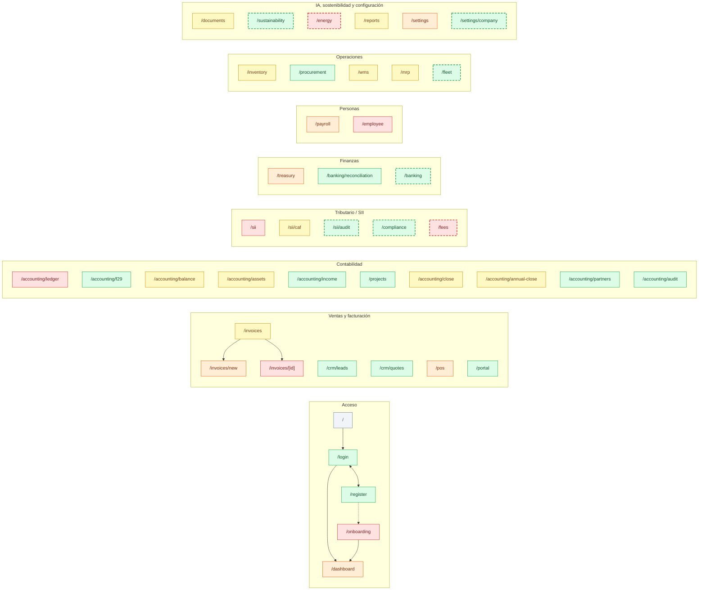

# Mapa Funcional — SII-ERP-AI (actualizado)

> Inventario de todas las pantallas del producto, cómo se llega a cada una, qué funciona de verdad y qué hay en el backend que no tiene pantalla. Es la base para reorganizar la navegación.
>
> **Versión actualizada al commit `9593ef8` (15-11-2026).** Reemplaza a `Doc/MAPA-FUNCIONAL.md` (datos del 14-11-2026), que quedó desfasado tras ese commit. Los cambios están en la sección 0.
>
> **Cómo se hizo:** para cada `page.tsx` se siguieron sus imports hasta los servicios y hooks; cada llamada `api.get/post/put/delete` y `fetch` se cruzó con los `@*Mapping` de los controllers. Los roles se tomaron del `@PreAuthorize` de cada controller (clase y método).
>
> **Limitación:** análisis estático. No se ejecutó la aplicación: "Conectada" significa que todas las llamadas apuntan a endpoints existentes, no que se probó en el navegador.

---

## 0. Cambios respecto de la versión del 14-11-2026

| Tema | Antes | Ahora |
|------|-------|-------|
| Crear factura | Rota (placeholder de 15 líneas) | **Con fallas**: `InvoiceForm.tsx` (336 líneas) llama a `POST /invoices`, pero el payload no calza con el backend |
| Libro diario, F29, Estado de resultados, Auditoría contable, Auditoría SII, Sincronizar SII, Dashboard, Energía | Sin API detectada | Clasificadas: el método nuevo sigue los imports. Ver sección 2 |
| Auditoría contable `/accounting/audit` | Sin acceso | **En el menú** como "Auditoría Tributaria" |
| Compliance `/compliance` | En el menú | **Sin acceso**: su entrada fue reemplazada |
| Flota y Energía | Sin acceso | Siguen sin acceso (el menú no las incluye) |
| Conciliación bancaria | Parcial con mock | Conectada |
| `/settings/company` | Simulada | Conectada (sigue sin acceso y duplica `/settings`) |
| Onboarding | Parcial, guarda el perfil | **Simulada**: no hay llamada a la API |
| Chat IA (`AiDrawer`) | Contenedor vacío | Panel lateral funcional montado en el layout |
| Menú | 18 entradas, 33 enlaces | **17 entradas, 29 enlaces**: POS y Portal B2B en un grupo nuevo "Ventas", separado de "Ventas CRM"; salen Compliance; entra Auditoría Tributaria |
| Endpoints inexistentes llamados por el front | 10 | **25 activos + 2 comentados** |
| Endpoints del backend | 224 | **226** (70 de energía). El microservicio B2B no expone ninguno |

---

## 1. Resumen

| | Cantidad |
|---|---|
| Pantallas (`page.tsx`) | **43** |
| Accesibles desde el menú | 29 |
| Accesibles solo por un link en otra pantalla | 2 (`/invoices/new`, `/invoices/[id]`) |
| Auth y raíz (login, registro, onboarding, `/`) | 4 |
| **Sin ningún acceso desde la interfaz** | **8** — ver §3 |
| Llamadas del front a endpoints que **no existen** | **25 activas + 2 comentadas** — ver §4 |
| Acciones simuladas | 5 — ver §5 |
| Endpoints del backend | 226 (70 son del módulo de energía) |
| Endpoints del microservicio B2B | **0** (no tiene controllers) |
| Roles que conoce el front | 3 de 9 (`ADMIN`, `ACCOUNTANT`, `USER`) |

**Por estado**

| Estado | Cantidad |
|--------|---------|
| Conectada | 18 |
| Parcial | 11 |
| Con fallas | 6 |
| Rota | 6 |
| Simulada | 1 |
| Redirección | 1 |

**Hallazgos principales para el diseño**
1. **Crear factura sigue sin funcionar de punta a punta.** El formulario existe y llama a `POST /invoices`, pero envía `type`, `clientRut`, `folio: 0` e `issuerRut: ""` (`InvoiceForm.tsx:92-104`); el backend exige `tipoDte`, `rutEmisor`, `razonSocialEmisor` y un folio positivo (`InvoiceController.java:105-125`). El comentario "Se asigna en el backend" no es cierto (RIESGOS R-02).
2. **El detalle de factura no funciona.** `/invoices/[id]` llama a 3 endpoints que no existen.
3. **El menú se muestra igual a todos los roles.** Un usuario de ventas ve Contabilidad, Remuneraciones, etc., y al entrar recibe errores de permiso.
4. **8 pantallas existen pero no se pueden abrir** desde la interfaz, entre ellas Honorarios, Compliance, Banca, Flota, Sostenibilidad y Energía.
5. **Hay pantallas que su propio público no puede usar**: el portal del empleado exige ADMIN o HR; Centro de Costos (en el menú de Contabilidad) no permite al contador; **"Auditoría Tributaria" usa `GET /accounting/f29`, que no permite al auditor**.
6. **El Libro Diario no muestra datos**: sus hooks devuelven valores vacíos fijos.

---

## 2. Inventario de pantallas

**Estados**
- **Conectada:** todas sus llamadas a la API existen en el backend.
- **Parcial:** funciona, pero le faltan acciones (p. ej. solo lectura aunque el backend permite crear) o conserva datos mock.
- **Con fallas:** alguna de sus llamadas apunta a un endpoint que no existe o es incompatible.
- **Rota:** su función principal no puede funcionar.
- **Simulada:** no llama a la API.

Columna *Roles*: los que acepta el backend en los endpoints que usa la pantalla (`@PreAuthorize`).

### 2.1 Ventas y facturación

| Ruta | Menú | Estado | Qué hace / qué pasa | Roles | Archivo (líneas) |
|------|------|--------|---------------------|-------|------------------|
| `/invoices` | Facturas | **Parcial** | Lista facturas (`GET /invoices` ✓) y las envía por email (`POST /invoices/{id}/send` ✓). **Importar CSV es simulado** (`CsvImportModal.tsx:39`), aunque el backend tiene `POST /invoices/import` | ADMIN, SALES, ACCOUNTANT | `invoices/page.tsx` (103) |
| `/invoices/new` | No (botón en `/invoices`) | **Con fallas** | `InvoiceForm` con líneas, IVA 19% y totales; llama a `POST /invoices` con un payload incompatible (ver hallazgo 1). El modo edición usa `PUT /invoices/{id}` ✗ | ADMIN, SALES, ACCOUNTANT | `invoices/new/page.tsx` (15) + `InvoiceForm.tsx` (336) |
| `/invoices/[id]` | No (clic en fila) | **Rota** | Llama a `GET /invoices/{id}` ✗, `GET /accounting/entries/by-invoice/{id}` ✗ y `GET /invoices/{id}/audit-trail` ✗ | ADMIN, SALES, ACCOUNTANT | `invoices/[id]/page.tsx` (214) |
| `/crm/leads` | Ventas CRM › Pipeline | Conectada | Leads: listar, crear, cambiar estado | ADMIN, SALES | `crm/leads/page.tsx` (103) |
| `/crm/quotes` | Ventas CRM › Cotizaciones | Conectada | Cotizaciones: listar, crear, aceptar, rechazar. No hay "convertir en factura" | ADMIN, SALES | `crm/quotes/page.tsx` (111) |
| `/pos` | Ventas › Punto de Venta | **Con fallas** | Ventas y sincronización ✓; **búsqueda de producto por código** (`GET /pos/products/search`) ✗. Ítems rápidos pendientes (`pos/page.tsx:86`) | ADMIN, SALES | `pos/page.tsx` (145) |
| `/portal` | Ventas › Portal B2B | Conectada | Portal del **cliente** B2B: sus pedidos, crear pedido, pagar. Layout propio (`app/portal/`), pero aparece en el menú interno. Usa el módulo `b2b` del backend principal | Sin `@PreAuthorize` | `portal/page.tsx` (65) |

### 2.2 Contabilidad

| Ruta | Menú | Estado | Qué hace / qué pasa | Roles | Archivo (líneas) |
|------|------|--------|---------------------|-------|------------------|
| `/accounting/ledger` | Contabilidad › Libro Diario | **Rota** | `useLedger` devuelve `[]` fijo y `useCleanupNovember` no hace nada (`useAccounting.ts:26-32`). El backend tiene `GET /accounting/entries` y `/ledger/{accountCode}`, sin uso | ADMIN, ACCOUNTANT | `accounting/ledger/page.tsx` (36) |
| `/accounting/f29` | Contabilidad › Form 29 | Conectada | Vista previa (`GET /accounting/f29` ✓) y envío (`POST /reports/f29/submit` ✓). Afectado por R-07 | ADMIN, ACCOUNTANT (envío también AUDITOR) | `accounting/f29/page.tsx` (32) + `F29Preview.tsx` (305) |
| `/accounting/balance` | Contabilidad › Balance | **Parcial** | `GET /accounting/balance-sheet` ✓. El árbol de cuentas usa datos mock (`BalanceSheetTree.tsx:24-94`) y `GET /accounting/accounts/tree` no existe | ADMIN, ACCOUNTANT | `accounting/balance/page.tsx` (76) |
| `/accounting/assets` | Contabilidad › Activos Fijos | Parcial | Lista y corre la depreciación ✓. **No permite crear activos** en la pantalla, aunque existe `POST /fixed-assets`. El servicio llama a GET, PUT y DELETE `/fixed-assets/{id}`, que no existen | ADMIN, ACCOUNTANT | `accounting/assets/page.tsx` (78) |
| `/accounting/income` | Contabilidad › Estado Resultados | Conectada | `GET /reports/income-statement` ✓. Sigue existiendo un segundo endpoint en `/accounting/reports/income-statement` | ADMIN, ACCOUNTANT, AUDITOR | `accounting/income/page.tsx` (98) |
| `/projects` | Contabilidad › Centro de Costos | Conectada | Proyectos: listar, ver, crear, cambiar estado. ⚠️ Está en el menú de Contabilidad, pero **el contador no tiene acceso** | ADMIN, OPERATIONS | `projects/page.tsx` (96) |
| `/accounting/close` | Contabilidad › ✨ Cierre de Período IA | Parcial | Auditoría y ejecución del cierre ✓ (`/period-close/audit`, `/execute`). Quedan restos de mock | ADMIN, ACCOUNTANT | `accounting/close/page.tsx` (416) |
| `/accounting/annual-close` | Contabilidad › 🌟 Cierre Anual (F22) | **Parcial** | Usa la auditoría del cierre de período (`POST /period-close/audit` ✓); **no calcula el F22** (`POST /annual-close/f22/calculate/{año}` sin uso) | ADMIN, ACCOUNTANT | `accounting/annual-close/page.tsx` (397) |
| `/accounting/partners` | Conciliación y Control › Cuentas Corrientes | Conectada | Saldos por cliente/proveedor ✓. No usa el detalle de movimientos (`/{rut}/movements`) | ADMIN, ACCOUNTANT | `accounting/partners/page.tsx` (28) |
| `/accounting/audit` | Conciliación y Control › Auditoría Tributaria | Conectada | Conciliación tributaria (`TaxReconciliationTable` sobre `GET /accounting/f29`). **No usa `/audit/*`**. ⚠️ El auditor no tiene acceso a `/accounting/f29` | ADMIN, ACCOUNTANT | `accounting/audit/page.tsx` (14) |

### 2.3 Tributario / SII

| Ruta | Menú | Estado | Qué hace / qué pasa | Roles | Archivo (líneas) |
|------|------|--------|---------------------|-------|------------------|
| `/sii` | SII › Sincronizar | **Rota** | `SyncStatusDashboard` llama a `GET /sii/status` ✗ y `POST /sii/sync` ✗. No usa `POST /sii/ops/fetch-rcv`, que sí existe. La carga de CAF embebida funciona | ADMIN, ACCOUNTANT | `sii/page.tsx` (28) |
| `/sii/caf` | SII › CAF | Parcial | Sube CAF ✓. **No existe un endpoint para listar los CAF cargados**, así que no se pueden ver folios disponibles | ADMIN, ACCOUNTANT | `sii/caf/page.tsx` (105) |
| `/sii/audit` | **No (sin acceso)** | Conectada | Mismo componente que `/accounting/audit` (duplicado). El backend tiene `GET /sii/audit/report` y `/accounting/audit/sii-mirror` sin uso | ADMIN, ACCOUNTANT | `sii/audit/page.tsx` (24) |
| `/compliance` | **No (sin acceso)** | Conectada | Panel de salud tributaria (`GET /compliance/dashboard` ✓). El método exige ADMIN o ACCOUNTANT aunque la clase admite AUDITOR | ADMIN, ACCOUNTANT | `compliance/page.tsx` (126) |
| `/fees` | **No (sin acceso)** | **Rota** | Lista con `GET /fees` ✗ (no existe). **Importar boletas es simulado** (`FeeImportModal.tsx:30`), aunque existe `POST /fees/import` | ADMIN, ACCOUNTANT | `fees/page.tsx` (43) |

### 2.4 Finanzas y tesorería

| Ruta | Menú | Estado | Qué hace / qué pasa | Roles | Archivo (líneas) |
|------|------|--------|---------------------|-------|------------------|
| `/treasury` | Tesorería | **Con fallas** | Pronóstico IA ✓. Tipos de cambio (`/treasury/exchange-rates`) ✗. **Registrar movimiento de caja es simulado**: el front usaría `/cash-entries` y el backend tiene `/cash-entry`. Subir cartola: simulado, sin backend. Tiene una pestaña de conciliación además de la pantalla propia. El backend ofrece flujo de caja diario y ratios financieros, sin uso | ADMIN, TREASURER, ACCOUNTANT | `treasury/page.tsx` (51) |
| `/banking/reconciliation` | Conciliación y Control › Conciliación Bancaria | Conectada | Conexiones, sincronizar, conciliar e ignorar ✓. ⚠️ **El contador no tiene acceso** | ADMIN, TREASURER | `banking/reconciliation/page.tsx` (162) |
| `/banking` | **No (sin acceso)** | Conectada | Conexiones bancarias (Open Banking) y movimientos | ADMIN, TREASURER | `banking/page.tsx` (64) |

### 2.5 Personas

| Ruta | Menú | Estado | Qué hace / qué pasa | Roles | Archivo (líneas) |
|------|------|--------|---------------------|-------|------------------|
| `/payroll` | Remuneraciones | **Con fallas** | **La lista de empleados no carga** (`GET /payroll/employees` ✗). Calcular ✓ (con `periodId: 1` fijo, `PayrollDashboard.tsx:25`), exportar Previred ✓, PDF de liquidación ✗ | ADMIN, HR | `payroll/page.tsx` (160) |
| `/employee` | Mi Portal (Empleado) | **Rota para su público** | Usa `GET /payroll/employee/payslips` ✓, pero `PayrollController` exige ADMIN o HR a nivel de clase (`PayrollController.java:20`): **un empleado normal recibe error de permiso** | ADMIN, HR | `employee/page.tsx` (63) |

### 2.6 Operaciones

| Ruta | Menú | Estado | Qué hace / qué pasa | Roles | Archivo (líneas) |
|------|------|--------|---------------------|-------|------------------|
| `/inventory` | Inventario | Parcial | Lista productos ✓; exportar Excel ✗. **No permite crear, editar ni registrar movimientos**, aunque el backend lo tiene | ADMIN, OPERATIONS | `inventory/page.tsx` (168) |
| `/procurement` | Adquisiciones | Conectada | Órdenes de compra: listar, ver, crear, marcar enviada y recibida | ADMIN, OPERATIONS | `procurement/page.tsx` (113) |
| `/wms` | Logística (WMS) | Parcial | Ubicaciones y picking: solo lectura y completar. **No permite crear** ubicaciones ni picking | ADMIN, OPERATIONS | `wms/page.tsx` (92) |
| `/mrp` | Producción (MRP) | Parcial | Listas de materiales y órdenes: solo lectura y completar. **No permite crear** | ADMIN, OPERATIONS | `mrp/page.tsx` (92) |
| `/fleet` | **No (sin acceso)** | Conectada | Métricas de flota (`/fleet/metrics`, único endpoint del módulo) | ADMIN, OPERATIONS | `fleet/page.tsx` (81) |

### 2.7 IA y documentos

| Ruta / componente | Menú | Estado | Qué hace / qué pasa | Roles | Archivo |
|-------------------|------|--------|---------------------|-------|---------|
| `/documents` | Gestor Documental (IA) | Parcial | Lista documentos y los analiza ✓. No hay subida en la pantalla | ADMIN, ACCOUNTANT | `documents/page.tsx` (71) |
| Chat IA (`AiDrawer` + `AiChat`) | Header y layout | Disponible | Panel lateral montado en el layout del dashboard; crea conversación y envía mensajes (`actions.tsx`) ✓. También se usa dentro de los cierres mensual y anual | Sin `@PreAuthorize` | `features/ai-assistant/` |

### 2.8 Sostenibilidad y energía

| Ruta | Menú | Estado | Qué hace / qué pasa | Roles | Archivo (líneas) |
|------|------|--------|---------------------|-------|------------------|
| `/sustainability` | **No (sin acceso)** | Conectada | Puntaje, reporte ESG y simulador Corfo | ADMIN, OPERATIONS, AUDITOR | `sustainability/page.tsx` (149) |
| `/energy` | **No (sin acceso)** | **Rota** | Llama a `/energy/stations`, `/metrics`, `/alerts` y `/charges`, que **no existen**; no usa ninguno de los **70 endpoints** reales (cargadores, precios, mantenimiento, OCPP) | ADMIN, OPERATIONS | `energy/page.tsx` (129) |

### 2.9 Inicio, configuración y acceso

| Ruta | Menú | Estado | Qué hace / qué pasa | Roles | Archivo (líneas) |
|------|------|--------|---------------------|-------|------------------|
| `/dashboard` | Dashboard | **Con fallas** | KPIs (`GET /dashboard/finance/metrics` ✓) y salud financiera (`/financial-shield/health` ✓). Actividad reciente (`GET /dashboard/recent-activity`) ✗ | Métricas: ADMIN, ACCOUNTANT, SALES · Salud: ADMIN, ACCOUNTANT, TREASURER | `dashboard/page.tsx` (66) |
| `/reports` | Reportes | Parcial | Reporte de ventas en Excel ✓. Otros tipos devuelven vacío (`reports/page.tsx:22`) | ADMIN, ACCOUNTANT, AUDITOR | `reports/page.tsx` (88) |
| `/settings` | Configuración | **Con fallas** | Perfil de empresa ✓, usuarios ✓, invitar ✓. **Eliminar usuario no funciona** (`DELETE /sso/users/{id}` ✗). Guardar preferencias de notificación (`PUT /notifications/preferences`) ✗. Cambiar rol existe en el backend y no se usa | ADMIN | `settings/page.tsx` (34) |
| `/settings/company` | **No (sin acceso)** | Conectada | Edita el perfil (`PUT /company/profile` ✓). Duplicado de `/settings` | ADMIN | `settings/company/page.tsx` (60) |
| `/login` | — | Conectada | Formulario de login → `/dashboard` | Pública | `(auth)/login/page.tsx` |
| `/register` | — | Conectada | Registro → `/login` | Pública | `(auth)/register/page.tsx` |
| `/onboarding` | — (solo tras registro) | **Simulada** | Asistente de 3 pasos; **no llama a la API** (solo un comentario, `onboarding/page.tsx:24`) | — | `(auth)/onboarding/page.tsx` (166) |
| `/` | — | — | Redirección | — | `app/page.tsx` (5) |

---

## 3. Pantallas sin acceso desde la interfaz

Existen, pero no hay ningún enlace a ellas: ni en el menú, ni en el header, ni en otras pantallas. Solo se abren escribiendo la URL.

| Pantalla | Estado | Comentario |
|----------|--------|------------|
| `/fees` Honorarios | Rota | Funcionalidad tributaria relevante (boletas de honorarios) |
| `/compliance` Compliance | Conectada | **Nueva en esta lista**: perdió su entrada del menú |
| `/banking` Conexiones bancarias | Conectada | Es el paso previo a la conciliación |
| `/sii/audit` Auditoría SII | Conectada | Duplicado de `/accounting/audit` |
| `/fleet` Flota | Conectada | |
| `/sustainability` Sostenibilidad | Conectada | |
| `/energy` Energía | Rota | |
| `/settings/company` | Conectada | Duplicado de `/settings`; probablemente se puede eliminar |

`/accounting/audit` salió de esta lista: ahora está en el menú.

---

## 4. Llamadas a endpoints que no existen

Rutas relativas a `SII-ERP-AI-FRONT/src/features/`.

| Llamada del front | Archivo | Efecto en la pantalla |
|-------------------|---------|-----------------------|
| `GET /invoices/{id}` | `invoicing/services/invoice.service.ts:69` | El detalle de factura no carga |
| `PUT /invoices/{id}` | `invoicing/services/invoice.service.ts:92` | No se puede editar una factura |
| `GET /invoices/{id}/audit-trail` | `accounting/services/accounting.service.ts:198` | No se ve el historial de la factura |
| `GET /accounting/entries/by-invoice/{id}` | `accounting/services/accounting.service.ts:189` | No se ve el asiento de la factura |
| `GET /accounting/accounts/tree` | `accounting/services/accounting.service.ts:272` | El árbol del balance usa mock |
| `GET /dashboard/recent-activity` | `dashboard/hooks/useRecentActivity.ts:16` | No se ve la actividad reciente |
| `GET /sii/status` | `sii/services/sii.service.ts:56` | No se ve el estado de sincronización |
| `POST /sii/sync` | `sii/services/sii.service.ts:64` | No se puede sincronizar |
| `GET /sii/dte/{tipo}/{folio}` | `sii/services/sii.service.ts:72` | No se consulta un DTE |
| `POST /sii/dte/{id}/send` | `sii/services/sii.service.ts:80` | No se envía un DTE al SII desde la UI |
| `GET /fees` | `fees/services/fee.service.ts:27` | La lista de honorarios no carga |
| `GET /payroll/employees` | `payroll/hooks/usePayroll.ts:19` | La lista de empleados no carga |
| `GET /payroll/payslip/{id}/pdf` | `payroll/components/PayrollDashboard.tsx:36` | No se descarga la liquidación |
| `GET /treasury/exchange-rates` | `treasury/services/treasury.service.ts:18` | No se muestran tipos de cambio |
| `GET /inventory/export/excel` | `inventory/components/InventoryDashboard.tsx:42` | Exportar inventario falla |
| `GET /pos/products/search` | `pos/services/pos.service.ts:47` | No se busca producto por código en el POS |
| `DELETE /sso/users/{id}` | `settings/services/settings.service.ts:93` | No se puede eliminar un usuario |
| `PUT /notifications/preferences` | `settings/services/settings.service.ts:103` | No se guardan las preferencias |
| `GET /fixed-assets/{id}` | `fixed_assets/services/fixedAssets.service.ts:30` | — |
| `PUT /fixed-assets/{id}` | `fixed_assets/services/fixedAssets.service.ts:40` | No se edita un activo |
| `DELETE /fixed-assets/{id}` | `fixed_assets/services/fixedAssets.service.ts:45` | No se elimina un activo |
| `GET /energy/stations` | `energy/services/energy.service.ts:6` | Energía no carga |
| `GET /energy/metrics` | `energy/services/energy.service.ts:11` | Energía no carga |
| `GET /energy/alerts` | `energy/services/energy.service.ts:16` | Energía no carga |
| `GET /energy/charges` | `energy/services/energy.service.ts:22` | Energía no carga |
| `POST /treasury/cash-entries` (comentada) | `treasury/components/CashEntryModal.tsx:44` | Ver §5 |
| `POST /treasury/statements/upload` (comentada) | `treasury/components/BankStatementUpload.tsx:23` | Ver §5 |

Además, `API_ROUTES` (`lib/constants.ts`) define rutas sin endpoint en el backend (`/sii/dte/send`, `/bank/upload`, `/bank/reconciliation`, `/bank/reconcile`, `/ai/chat`, `/accounting/entries/correct`). **Ninguna pantalla las usa**: se pueden eliminar.

---

## 5. Acciones simuladas

| Acción | Archivo | ¿Existe en el backend? |
|--------|---------|------------------------|
| Importar facturas CSV | `invoicing/components/CsvImportModal.tsx:39` | **Sí**: `POST /invoices/import` — solo falta conectarlo |
| Importar boletas de honorarios | `fees/components/FeeImportModal.tsx:30` | **Sí**: `POST /fees/import` — solo falta conectarlo |
| Registrar movimiento de caja | `treasury/components/CashEntryModal.tsx:44` | **Sí**, como `POST /treasury/cash-entry` (el front usa `cash-entries`) |
| Subir cartola bancaria | `treasury/components/BankStatementUpload.tsx:23` | No |
| Guardar el onboarding | `(auth)/onboarding/page.tsx:24` | Parcial: `PUT /company/profile` existe; no hay carga de certificado en ese flujo |
| Progreso de subida de CAF | `sii/components/CAFUpload.tsx:51` | La subida es real; la barra de progreso es simulada |

---

## 6. Backend sin pantalla

| Área | Endpoints sin uso en el front | Para qué sirven |
|------|-------------------------------|-----------------|
| Contabilidad | `GET /accounting/entries`, `/accounting/accounts` (GET, POST), `/opening-balance` y `/opening-balance/upload`, `/ledger/{accountCode}`, `/periods/closed`, `/periods/{period}/status` | Libro diario real, plan de cuentas, saldos de apertura, libro mayor por cuenta, estado de períodos |
| Reportes | `/reports/weekly/generate`, `/reports/balance-sheet` | Reporte semanal, balance en reportes |
| Auditoría | `/audit/alerts`, `/duplicates`, `/suspicious`, `/reconciliation`, `/report`; `/sii/audit/report`; `/accounting/audit/sii-mirror` y `/sii-sync` | Detección de anomalías y espejo SII–ERP |
| Clasificación automática | `/learning/rules` (CRUD completo) | Reglas de clasificación contable |
| Limpieza de datos | `POST /accounting/cleanup/november-rcv` (solo ADMIN) | Limpieza puntual de un mes; **revisar si debe seguir en producción**. El Libro Diario tiene un botón para esto, hoy sin efecto |
| SII | `POST /sii/ops/fetch-rcv`, `POST /invoices/import/sii-csv` | Descargar RCV, importar CSV del SII |
| Cierre anual | `POST /annual-close/f22/calculate/{año}` | Cálculo del F22 |
| Tesorería | `/treasury/cash-flow-daily`, `/financial-ratios`, `POST /treasury/cash-entry` | Flujo de caja diario, ratios, movimientos de caja |
| Cuentas corrientes | `/accounting/ledger/partners/{rut}/movements` | Detalle de movimientos |
| Usuarios y organización | `/users/*` (11), `/roles/*` (7), `/organizations/*` (9) | Segunda gestión de usuarios, más completa que la de `/sso/users` |
| SSO | `PUT /sso/users/{id}/role`, invitaciones (`/invite/validate`, `/register-invite`) | Cambiar rol; aceptar una invitación |
| Inventario | Crear, editar y eliminar producto; movimientos por producto | Gestión completa de inventario |
| WMS / MRP | Crear ubicación, picking, BOM, orden de trabajo | Altas de registros |
| IA | `/ai/knowledge` (subir, buscar; solo ADMIN), `/dms/ai-invoicing/process` | Base de conocimiento y extracción de facturas con IA |
| Notificaciones | `/notifications/subscribe` | Notificaciones en tiempo real |
| Energía | **70 endpoints**: mantenimiento, precios y campañas, reportes y pronósticos, alertas y métricas (`/dashboard/*` de energía), fabricantes y modelos de cargadores, control remoto OCPP | Gestión completa de una red de cargadores eléctricos |

Salieron de esta lista porque ahora se usan: `POST /invoices`, `/reports/income-statement`, `/reports/f29/submit`, `/sustainability/score`.

---

## 7. Roles y navegación

**El front solo conoce 3 roles** (`ROLES` en `lib/constants.ts`: ADMIN, ACCOUNTANT, USER) y **el menú no filtra por rol**: todos ven las 17 entradas y 29 enlaces.

Verificado contra el `@PreAuthorize` de los 51 controllers:

| Rol | Áreas que el backend le permite |
|-----|---------------------------------|
| ADMIN | Todo |
| ACCOUNTANT | Facturación, contabilidad, SII y CAF, compliance, honorarios, activos, cierres, documentos, tesorería (no banca), reportes, auditoría SII, salud financiera |
| TREASURER | Tesorería, banca y conciliación, salud financiera |
| SALES | Facturación, CRM, POS, métricas del dashboard |
| OPERATIONS | Inventario, adquisiciones, WMS, MRP, flota, proyectos, energía, sostenibilidad |
| HR | Remuneraciones |
| AUDITOR | Auditoría (`/audit/*`), auditoría SII, reportes, estado de resultados, sostenibilidad, reportes de energía. **No** al panel de compliance ni a `/accounting/f29` |
| USER | Ninguna área propia (ni siquiera el portal del empleado) |
| B2B_CLIENT | Nada lo exige explícitamente; el portal B2B no tiene restricción |

Controllers sin `@PreAuthorize`: `AuthController` y `EconomicIndicatorsController` (justificados); `CustomerOrderController`, `AiAssistantController`, `NotificationController` (RIESGOS R-23).

**Inconsistencias**
- **Centro de Costos** está en el menú de Contabilidad, pero es solo para ADMIN y OPERATIONS.
- **Conciliación Bancaria** no permite al contador.
- **Mi Portal (Empleado)** solo permite ADMIN y HR.
- **Portal B2B** (para clientes externos) aparece en el menú interno, y su backend no tiene restricción de rol.
- **Auditoría Tributaria** está en el menú, pero usa un endpoint que el **AUDITOR** no puede llamar; las pantallas pensadas para él (`/audit/*`) no existen en el front.

---

## 8. Sitemap

**Leyenda:** verde = conectada · amarillo = parcial · naranja = con fallas · rojo = rota o simulada · gris = redirección · **borde punteado = sin acceso desde la interfaz**. Las flechas son los únicos enlaces entre pantallas que existen fuera del menú.

---

## 9. Observaciones para el diseñador

Se mantienen las de la versión anterior, con estos ajustes. Las propuestas concretas están en `PLAN-REDISENO.md`.

**Funcionalidad repetida**
- **Dos sistemas de usuarios:** `/sso/users` (el que usa Configuración) y `/users` + `/roles` + `/organizations` (más completo, sin pantalla).
- **Conciliación en dos lugares:** pestaña dentro de Tesorería y pantalla propia en `/banking/reconciliation`.
- **Auditorías:** `/accounting/audit` y `/sii/audit` son **la misma pantalla**; las alertas `/audit/*` y el espejo SII siguen sin pantalla.
- **Dos estados de resultados** en el backend.
- **Cierre mensual y anual** como pantallas separadas de un mismo proceso.
- **Dos perfiles de empresa** en el front (`/settings` y `/settings/company`).
- **Dos B2B:** el microservicio `SII-ERP-B2B-SERVICE` no expone endpoints; el portal usa el módulo `b2b` del backend principal.

**Agrupación del menú**
- El grupo "Conciliación y Control" mezcla Auditoría Tributaria, Conciliación Bancaria (finanzas) y Cuentas Corrientes (contabilidad).
- Centro de Costos está en Contabilidad, pero es de Operaciones.
- Banca (conexiones) debería estar junto a Conciliación.
- Honorarios y Compliance son tributarios y hoy no aparecen en ninguna parte.

**Módulos por rubro.** Energía (70 endpoints), Flota, MRP, WMS, POS, Portal B2B y Sostenibilidad son verticales que no aplican a todas las empresas.

**Pantallas que hay que diseñar casi desde cero**
1. Detalle de factura (`/invoices/[id]`): estado SII, asiento, historial.
2. Lista de CAF con folios disponibles.
3. Portal del empleado (requiere además corregir permisos).
4. Libro diario (hoy sin datos).
5. Gestión de usuarios y roles.
6. Energía, si el módulo sigue en el producto.

Crear factura sale de esta lista: ya existe un formulario; requiere rediseño del flujo y corregir el contrato con el backend.

---

## 10. Pendiente de verificar

1. ~~Llamadas hechas con constantes (`API_ROUTES`).~~ **Resuelto:** ninguna pantalla usa `API_ROUTES`; las pantallas "en gris" se clasificaron siguiendo sus imports.
2. ~~Si el chat de IA se muestra.~~ **Resuelto:** `AiDrawer` monta `AiChat` en un panel lateral.
3. ~~De dónde saca sus datos el dashboard principal.~~ **Resuelto:** `/dashboard/finance/metrics` y `/financial-shield/health`.
4. **Nuevo:** confirmar en ejecución las 18 pantallas "Conectada".
5. **Nuevo:** confirmar que `POST /invoices` responde 400 con el payload actual de `InvoiceForm`.
